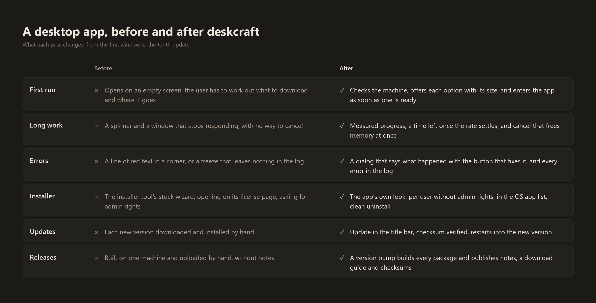

# deskcraft

Written by Michael Araque ([@michyaraque](https://x.com/michyaraque)) from taking a desktop app from prototype to public releases.



deskcraft is a skill for Claude Code, Codex and Google Antigravity that builds or tunes a commercial desktop app from A to Z, the parts a demo skips: a coherent interface, a first run that ends in a first result, long work with real progress and cancel, errors people can act on, an installer that looks like the product and needs no admin rights, updates from inside the app, a release pipeline, code signing and a repository ready to go public. It works with any stack, like Tauri, Electron, Qt, Flutter, .NET, SwiftUI, GTK or a Rust GPU UI, on Windows, macOS and Linux.

## Install

For Claude Code, install it as a plugin:

```bash
claude plugin marketplace add michyaraque/deskcraft
claude plugin install deskcraft@michyaraque
```

Add `--scope project` to the install and commit `.claude/settings.json` to turn it on for everyone working in a project. Then start a new session, or run `/reload-plugins`. To update, run `claude plugin update deskcraft@michyaraque`.

For Codex or Google Antigravity, ask the agent to install the skill from `https://github.com/michyaraque/deskcraft/tree/master/skills/deskcraft`, or copy the `skills/deskcraft` folder into `~/.agents/skills/` (Codex) or `~/.gemini/config/skills/` (Antigravity).

## Use

In Claude Code, type `/deskcraft` with what you want, or ask in your own words:

```
/deskcraft audit this app before the first public release
/deskcraft add an installer and an updater
/deskcraft set up releases on version bump with checksums
/deskcraft start a new desktop app for editing maps, Tauri, Windows and macOS
```

It audits first and writes a five-line brief (product, weakest machine, platforms, distribution, identity), then waits for your answer before changing anything.

## What it does

- **Audit.** Lists every sign of an unfinished app with where it lives, starting with mechanical checks the agent runs on the repository: missing project files, secrets, developer paths, version drift, no updater, sloppy interface strings, locks taken twice, generated attribution lines in commits.
- **Passes, in order.** Identity, shell and interface system, first run, long work and errors, data and privacy, installer, updates, release pipeline, signing and launch.
- **Verification like a user.** Install, update and uninstall in a throwaway profile, the slow path with a cold cache and a small screen, and screenshots without touching your desktop.
- **Templates.** A release workflow that publishes `App vX.Y.Z` with notes from the changelog, a download guide and `SHA256SUMS.txt` on every version bump, plus a changelog and a security policy to start from.

The skill is documentation only: Markdown, YAML and images, with no scripts to run.

## License

[MIT](LICENSE).
